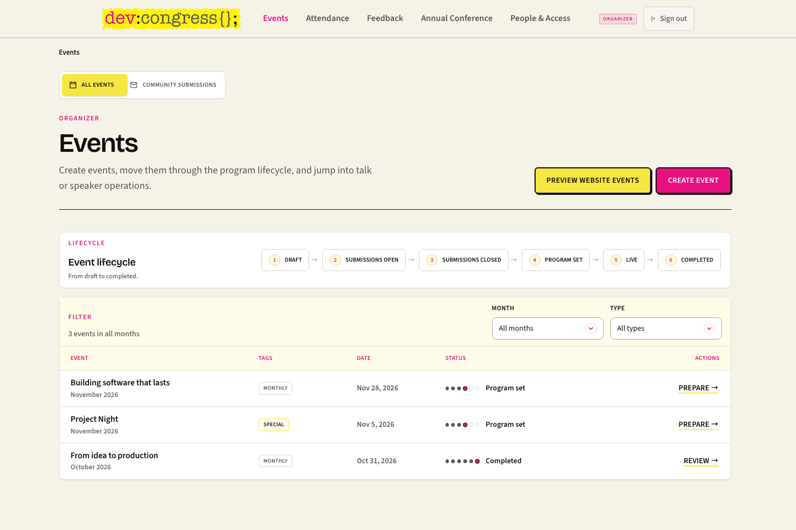
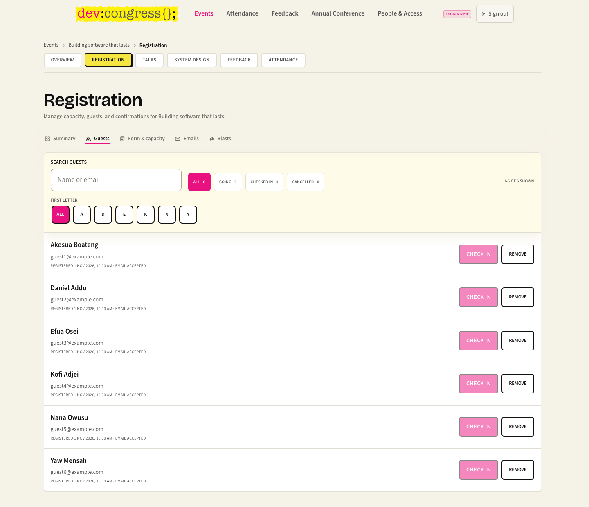
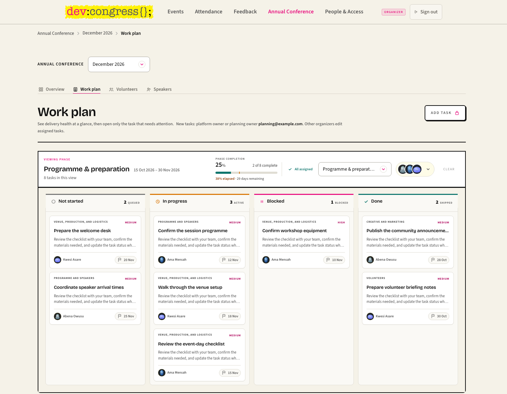
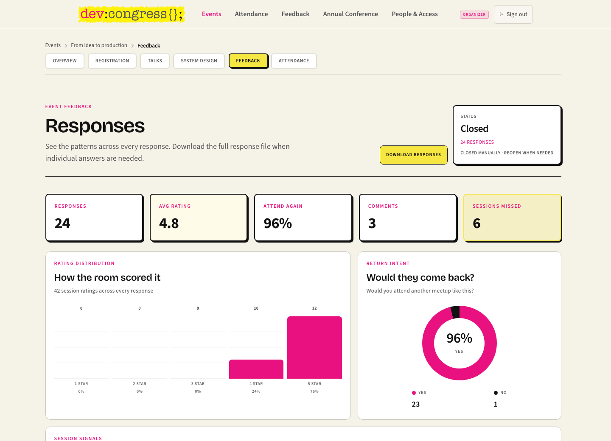
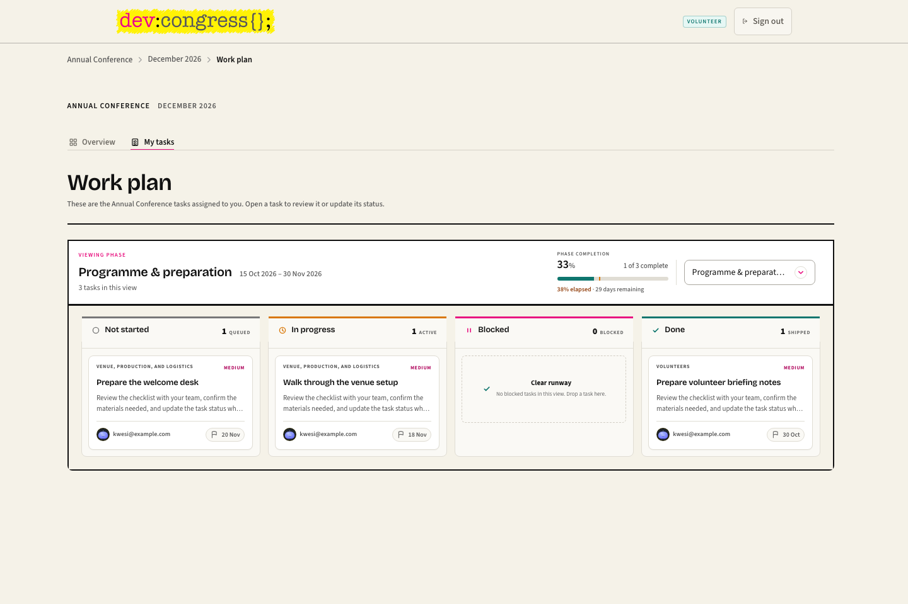
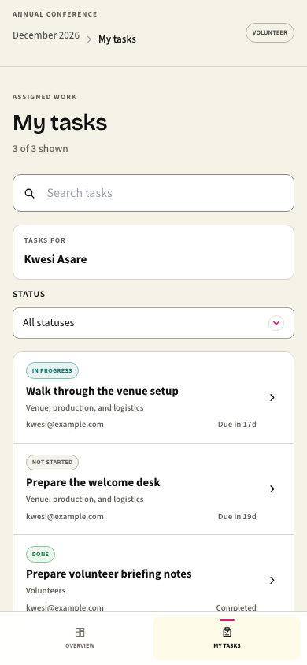

# DevCongress Community

[](https://github.com/devcongress/events-management/actions/workflows/ci.yml)
[](docs/README.md)
[](https://em.devcongress.org)
[](https://events-management.admins-a7d.workers.dev)

[](https://vuejs.org/)
[](https://www.typescriptlang.org/)
[](https://vite.dev/)
[](https://hono.dev/)
[](https://bun.sh/)
[](https://pnpm.io/)
[](LICENSE)

DevCongress Community is the workspace behind DevCongress meetups and the annual conference. Organizers prepare events, manage registrations, coordinate speakers, and learn from attendee feedback. Volunteers follow their assigned conference tasks and keep the team updated, on a laptop or a phone.

The app is built with Vue 3, Vite, and a Hono API, backed by Supabase and Cloudflare.

[Organizer tour](#for-organizers) · [Volunteer tour](#for-volunteers) · [Quick start](#quick-start) · [Documentation](#documentation)



*The organizer’s starting point: see each event’s stage and open the next piece of work.*

> Screenshots show the real app with synthetic demonstration data. This tour covers Organizer and Volunteer access only. Available actions depend on your role, assignments, and edition-specific permissions.

---

## For organizers

### Take an event from idea to follow-up

The **Events** workspace follows a meetup from draft through speaker submissions, programme preparation, the live event, and completion. Open an event to work through its overview, registrations, talks, System Design session, feedback, and attendance. Community event proposals have their own review section.

See [event operations](docs/user-guides/organizer-guide.md#manage-events) for the complete workflow.

### Manage guests and check-in

**Registration** separates the summary, guest list, form and capacity, email delivery, and guest messages. Search by name or email, filter the list, and use check-in when the event’s check-in window is open. Capacity and waitlist handling belong to the same event workspace.

<details>
<summary>See the organizer guest list</summary>



*This sample event is still upcoming, so its check-in controls are disabled. The screenshot contains demonstration addresses only.*

</details>

Read about [native registration](docs/features/native-registration.md).

### Coordinate the conference work plan

The **Annual Conference → Work plan** board groups tasks by status, with phase progress, owners, priorities, and target dates alongside the work. Organizers can review the plan and edit tasks assigned to them; creating tasks and managing the full plan require the corresponding planning permission.



*Filter by phase or owner, then open a task for its details. The sample organizer has the standard role, without full-plan management access.*

See [annual conference planning](docs/user-guides/organizer-guide.md#plan-the-annual-conference).

### Learn from each meetup

The **Feedback** workspace brings responses, session ratings, return intent, comments, and missed sessions together. Organizers can download responses and manage whether the form is open. “Did not attend” stays separate from numeric ratings.



*Example results from a closed feedback form; these are not real event statistics.*

Read about [feedback](docs/features/feedback.md).

## For volunteers

### Know what is yours to do

Volunteers start with **Overview** and **My tasks** for their conference edition. Their default view contains only tasks assigned to them as an accountable owner or collaborator. They can review task details and update status; internal organizer notes and task-detail editing are not part of this default access.



*The same work plan, narrowed to the volunteer’s responsibilities. Additional edition-specific responsibilities can expand access.*

### Keep up from a phone

On a phone, **My tasks** becomes a compact list with search, status filtering, and due dates. Open a task to review it and update its status without navigating the desktop board.

<p align="center">
  
</p>

The [Organizer Guide](docs/user-guides/organizer-guide.md#plan-the-annual-conference) explains the shared conference workflow and the differences in volunteer access.

---

## Quick Start

### For Contributors

Bring your curiosity; the fastest way to understand the app is to seed it, make an event move through its lifecycle, and follow the data into the organizer workspace.

```bash
pnpm install
cp .env.example .env.local
pnpm seed
pnpm dev
```

The local Vite server starts the Vue app and same-origin Hono API, usually at `http://localhost:5173`.

See [Local Development](docs/technical/local-development.md) for environment variables, Supabase notes, seed data, and troubleshooting.

### Common Commands

```bash
pnpm dev                # Start local dev server
pnpm seed               # Reset JSON mock data
pnpm typecheck          # Run Vue/TypeScript checks
pnpm build              # Typecheck and build production assets
pnpm start              # Serve the built app with Bun
pnpm test               # Run Vitest tests
pnpm verify:public-api  # Verify public meetup API contract
```

---

## Documentation

Start with the centralized [Documentation Map](docs/README.md) if you are unsure where to go next.

### User Guides

| Guide | Description |
|---|---|
| [Community Guide](docs/user-guides/community-guide.md) | Public event, CFP, archive, feedback, and System Design learning-room flows |
| [Organizer Guide](docs/user-guides/organizer-guide.md) | Event operations, talks, speakers, attendance, feedback, and System Design learning rooms |

### Technical Documentation

| Document | Description |
|---|---|
| [Architecture](docs/architecture.md) | App shape, route groups, API surface, persistence, realtime, and auth strategy |
| [Implementation Notes](docs/implementation.md) | Entry points, module breakdown, constants, and key flows |
| [Local Development](docs/technical/local-development.md) | Setup, scripts, seed data, environment variables, and troubleshooting |
| [Migration Delivery Gate](docs/technical/migration-delivery-gate.md) | Read-only schema-contract checks, required audit-environment configuration, and delivery boundaries |
| [Auth](docs/auth.md) | Supabase-only organizer auth, roles, sessions, and security notes |
| [Public Meetup API](docs/public-meetups-api.md) | Read-only meetup API contract for `devcongress.org` integration |
| [Technical Debt](docs/reference/technical-debt.md) | Evidence-backed production and architecture debt register |

### Reference

| Document | Description |
|---|---|
| [Routes](docs/reference/routes.md) | Public, organizer, and API route map |
| [Technical Debt](docs/reference/technical-debt.md) | Production-readiness and contributor planning backlog |
| [Decisions](docs/decisions.md) | Architecture decision records |
| [Changelog](docs/changelog.md) | Feature-level project history |

### Features

| Feature | Status | Description |
|---|---|---|
| [Event Publishing](docs/features/event-publishing.md) | Active | Create, publish, and expose meetups to the public API |
| [Luma Attendance](docs/features/luma-attendance.md) | Active | Import Luma CSV exports and review attendance insights |
| [Feedback](docs/features/feedback.md) | Active | Route feedback and event-scoped post-event forms |

[How to document new features](docs/features/README.md) · [Refresh these screenshots](docs/images/readme/README.md)

---

## Technology Stack

- **Frontend:** Vue 3, Vite 6, TypeScript, Vue Router, TanStack Query, Tailwind CSS
- **API:** Hono through Vite in development, with Cloudflare Worker and Bun server entry points
- **Persistence:** Supabase/Postgres, with JSON compatibility storage for domains still being migrated
- **Media:** Supabase Storage for meetup cover and photo uploads
- **Testing:** Vitest, vue-tsc, public API verification script
- **Deployment:** Cloudflare Pages, Cloudflare Workers, Supabase

---

## Contributing

Contributions are welcome. Read [CONTRIBUTING.md](CONTRIBUTING.md) before opening a pull request, and update the relevant file under [docs/](docs/README.md) when a feature, workflow, route, or architecture boundary changes.

---

## Security

Do not commit real secrets. Use `.env.local` for local credentials and keep server-only keys out of browser-prefixed variables.

If you find a vulnerability, follow [SECURITY.md](SECURITY.md).

---

## License

This project is available under the [MIT License](LICENSE).
